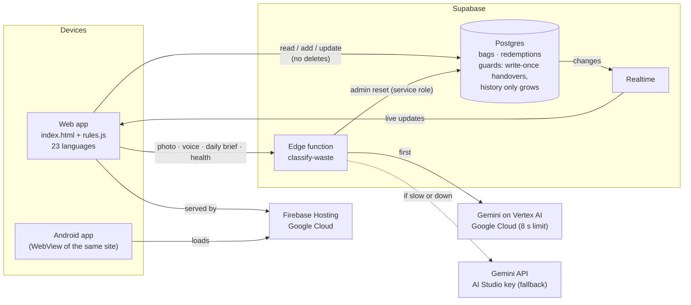

# CleanCare Waste Tracker

[](https://github.com/shivanshrrp/cleancare/actions/workflows/checks.yml)

Tracks biomedical waste bags in small clinics, from the clinic to treatment.

- **Live (Google Firebase Hosting):** https://cleancare-srrp.web.app
- Mirror (GitHub Pages): https://shivanshrrp.github.io/cleancare/
- Android app: https://github.com/shivanshrrp/cleancare/releases/latest/download/CleanCare.apk
- No account needed: **Try demo** on the sign-in screen, or sign in with a test account (see *Sign-in*).

## Architecture



The browser never holds an AI key or the database's service key; both stay in the edge function. Every rule that
protects a bag's history is enforced by the database itself, so it holds whoever writes (the app, the raw API or a script).

## Where to find each piece

| Area | What is built | Where |
| --- | --- | --- |
| Working product | Full chain of custody (log → collect → in transit → received → treated), QR labels and scanning, live sync across devices, five roles, web and Android | `index.html`, live links above |
| Google AI (Gemini) | Three features through one server function: **photo check** (image → CPCB bag colour, confidence, safe-handling step), **voice check** (staff describe an item in any Indian language → transcript + colour), **AI daily brief** for the regulator. Grounded in Schedule I of the BMW Rules 2016; JSON output checked against a schema; low-confidence answers ask for a retry; runs on **Vertex AI** first and falls back to the Gemini API key if Vertex is slow (8 s) or down, and to a second model when the first is busy; replies in the user's language. **Measured: 20 of 20 correct, median 1.6 s** on spoken items in Hindi, English and Tamil ([docs/ai-eval.md](docs/ai-eval.md)) | `supabase/functions/classify-waste/index.ts`, `tools/eval-voice.py` |
| Google Cloud | Hosted on Firebase Hosting and Gemini served by Vertex AI, both in project `cleancare-srrp`; Gemini API key from Google AI Studio as the fallback; Google Noto fonts for all Indian scripts | `firebase.json`, `.firebaserc` |
| Engineering | Static app with no build step; Supabase Postgres + realtime; server-side API key, origin allowlist and rate limit; the database itself enforces the chain of custody (write-once handovers, history that only grows, ID and weight checks); visitors cannot delete data; live health check (About screen). **66 automated checks, run by GitHub Actions on every push**: 22 on the rules, 28 on the server function, 16 on the database guards (on a real Postgres), plus the translation checker | `rules.js`, `tools/test-rules.js`, `test.ts`, `supabase/guard-test.sql`, `.github/workflows/checks.yml` |
| Accessibility and UX | English + all 22 Eighth Schedule languages (11 complete), right-to-left Urdu/Kashmiri/Sindhi, dark mode, WCAG AA contrast, 44 px tap targets, onboarding and demo mode | `translations.js`, `translations/` |
| Problem fit | Built around the CPCB colour rules, the 24-hour CBWTF rule and the 10% weight check at every handover | *Chain of custody* below |

| Role | What it does |
| --- | --- |
| **Clinic** | **Rewards** card with the clinic's point balance, this month's points by colour, deductions and leaderboard rank; **Redeem points** for supplies. Log a bag (category, weight). It gets an ID and QR code, and **Print label** makes a visiting-card-size (89 × 51 mm) PDF label. **Not sure? Scan an item** photographs a loose item, or staff **describe it by voice** in any language, and Google Gemini suggests its bag colour with its confidence and a safe-handling step, in the user's language (staff confirm before saving) |
| **Collector** | For the collection crew. Scan or type the bag ID at pickup and record the weight (and flag a wrong colour or contamination), then **Start trip** when the vehicle leaves: every bag on board is marked *In transit* at that time, with the vehicle number |
| **Facility** | For staff at the treatment plant (CBWTF), not the collector. Confirm each bag on arrival with its weight and a colour check, then record the treatment method and certificate |
| **Monitor** | Today's counts, activity and exceptions: bags missed at pickup, uncollected after 24 h, not received at the CBWTF within 24 h of pickup (the CPCB rule), or with a weight change over 10% at any handover. Each clinic is listed with its registration code. Also the month's reward points split into government- and CBWTF-funded shares, a table of mis-sorted bags, and a separate list of **inactive clinics** (no bag logged in `INACTIVITY_DAYS`, or never) · **AI daily brief**: Google Gemini summarises today's figures and suggests follow-ups, in the regulator's language, from the numbers alone (no patient data exists to send) |
| **Leaderboard** | Clinics ranked by this month's points; only names and totals, top 3 highlighted, your clinic marked |
| **Track** | A parcel-style timeline for any bag, showing the date and time of every checkpoint; links like `?track=CL-ABC-00231` open it directly |

A single static page (`index.html`) with no build step. Data is shared in real time through Supabase.

## Files

| File | What it is |
| --- | --- |
| `index.html` | The app: screens, data access and translations wiring |
| `rules.js` | The rules, kept apart from the screens: exceptions, the CPCB 24-hour rule, weight checks, reward points, leaderboard, inactive clinics. `deno run --allow-read tools/test-rules.js` checks them (22 checks, fixed clock) |
| `translations.js`, `translations/` | All interface text: English, Hindi and Marathi inline, the other 20 languages as separate files. See *Languages* below |
| `firebase.json`, `.firebaserc` | Firebase Hosting setup (what is published, and the project) |
| `config.js` | Your Supabase URL and key. Leave blank for demo mode, where each browser keeps its own data |
| `supabase-setup.sql` | Creates the database tables (bags, redemptions) and the rules the database enforces. Safe to re-run. `supabase/guard-test.sql` checks those rules in the SQL Editor (16 checks, always rolled back) |
| `supabase/functions/classify-waste/` | Server function for every Google Gemini feature: the photo check, the voice check and the Monitor's AI daily brief. It also runs the admin's **Reset Demo**, the only path that can delete rows (sample bags only). It grounds Gemini in the BMW Rules 2016 colour coding, asks for JSON that matches a schema, checks the reply, and falls back to a second model when the first is busy. Needs the `GEMINI_API_KEY` secret (from Google AI Studio) in Supabase → Edge Functions → Secrets. Set `VERTEX_API_KEY` (Google Cloud, Vertex AI) to have it answer first; `GEMINI_API_KEY` is the fallback, and one of the two is enough. `test.ts` checks it (28 checks) with Gemini and the database stubbed. Its `health` task reports whether Gemini and the database are reachable (shown on the About screen): `GEMINI_API_KEY=test deno run --allow-net --allow-env supabase/functions/classify-waste/test.ts` |

## 1. Set up the shared database (Supabase, free)

1. Sign up at https://supabase.com and create a new project (any name and region).
2. Open **SQL Editor → New query**, paste in all of `supabase-setup.sql`, and click **Run**.
3. Open **Project Settings → API** (or **Connect**) and copy:
   - the **Project URL**
   - the **anon** / **publishable** key. Never use the `service_role` / secret key; it would be public on the site.
4. Paste both into `config.js`.

The first time the site opens, it loads sample bags from 10 clinics into the database. **Reset Demo** reloads them.

## 2. Put it live

**Firebase Hosting (Google Cloud):** nothing to install, run from this folder
```bash
npx firebase-tools login
npx firebase-tools deploy --only hosting
```
`firebase.json` publishes only the app files (not `.git`, `supabase/` or `tools/`). Add the new site address to
`ALLOWED_ORIGINS` in the server function, or the Gemini features are refused there.

**GitHub Pages (mirror):**


1. Create a new **public** repository on GitHub, e.g. `cleancare`. Don't add a README.
2. Push this folder:
   ```bash
   git remote add origin https://github.com/<your-username>/cleancare.git
   git push -u origin main
   ```
3. On GitHub: **Settings → Pages → Build and deployment → Source: Deploy from a branch**, then
   **Branch: `main` / `(root)` → Save**.
4. After a minute or so the site is live at `https://<your-username>.github.io/cleancare/`.

Live camera scanning works on the live site because GitHub Pages serves it over HTTPS.

To update the site later, commit and `git push`. Pages redeploys automatically.

## Chain of custody

Each bag keeps an ordered list of timestamped events, one per handover, in the `events` column:

| Step | Who scans it | Recorded |
| --- | --- | --- |
| `logged` | Clinic | time, clinic, weight |
| `collected` | Collector | time, collector ID, weight at pickup |
| `in_transit` | Collector (Start trip) | time, collector ID, vehicle |
| `received` | CBWTF staff (Facility) | time, facility name, arrival weight |
| `treated` | CBWTF staff (Facility) | time, facility name, treatment method, certificate |

Track draws its timeline from these events, and the exception checks read them too: each weighed handover is
compared with the one before it. The stage columns (`status`, `collected_at`, …) still hold each bag's current
state, so older bags without events get a history rebuilt from them.

The sample clinics are small facilities (clinics, dental practices, pathology labs, diagnostic centres). Each
has a three-letter code used in bag IDs and a registration code made of five letters from its name, the
pincode, state code, facility type (CL, DH, PL, DC) and a serial number, e.g. `SAHYA-411030-MH-PL-005`.

## Reward points

Clinics earn points, never money, and spend them on healthcare supplies. The ₹ figures in the app are only a
reference (`POINTS_PER_RUPEE`, 10 points ≈ ₹1). All the numbers are constants at the top of the script in `index.html`:

| Constant | Meaning |
| --- | --- |
| `CLINIC_POINTS` | Points per verified kg: White 60, Yellow 50, Red 30, Blue 20 (placeholders) |
| `PENALTY_POINTS` | −25 per mis-sorted bag |
| `GOVT_FUNDED_SHARE` | Share of issued points funded by government (0.6); the CBWTF funds the rest |
| `REWARD_CATALOGUE` | Supplies clinics can request, a growing list of `{ id, pointCost, name }`. Add an item with one line; `name` can be plain text or `{ en, hi, mr }` |
| `INACTIVITY_DAYS` | Days without a logged bag before a clinic shows as inactive (3). A reminder only: it never costs points |

Points are never stored. They're worked out from each bag's events every time: a bag earns kg (as weighed at the
CBWTF) × the rate for its colour once it has been logged, collected and received at the CBWTF with the weight at each
handover within 10%, counted in the month it was received. If the collector or CBWTF corrects the colour, or finds
wrong items mixed in, a `reclassified` or `contamination` event is added to the bag with −25 points, so every
deduction shows in the bag's history. The only separate data is the `redemptions` table (what was requested with
points), created by `supabase-setup.sql`.

## Languages

The app covers English plus all 22 languages of the Eighth Schedule. Users pick one from the searchable menu in the
header, which shows each language in its own script, grouped by script family. The choice is remembered on each
device and passed to the Android app for its offline screen. Urdu, Kashmiri and Sindhi switch the whole layout to
right-to-left. Fonts come from Google's Noto families, and a browser only downloads the scripts it actually shows.

| Quality | Languages |
|---|---|
| **Complete, 508 of 508 strings** | English, हिन्दी Hindi, मराठी Marathi, বাংলা Bengali, தமிழ் Tamil, తెలుగు Telugu, ગુજરાતી Gujarati, ಕನ್ನಡ Kannada, മലയാളം Malayalam, ਪੰਜਾਬੀ Punjabi, اردو Urdu |
| **Core screens, about 220 strings. Best effort, needs native review** | नेपाली Nepali, संस्कृतम् Sanskrit, मैथिली Maithili, डोगरी Dogri, कोंकणी Konkani, অসমীয়া Assamese, ଓଡ଼ିଆ Odia, سنڌي Sindhi |
| **Partial, 40 to 140 strings. Best effort, needs native review** | बर' Bodo, کٲشُر Kashmiri, ꯃꯩꯇꯩꯂꯣꯟ Manipuri (Meitei Mayek), ᱥᱟᱱᱛᱟᱲᱤ Santali (Ol Chiki) |

For partial languages, any string not yet translated shows in English. Their menu entries are tagged "Partly
translated", and each file starts with a `REVIEW NEEDED` comment. Please have a native speaker check them before
using them with real clinics.

**Where the text lives:**
- `translations.js` holds English, Hindi and Marathi, plus the language list (`CLEANCARE_LANGUAGES`: code, native
  name, script group, direction, review flag).
- Each other language is a file in `translations/<code>.js` with the same flat keys. It is loaded only when someone
  picks that language.
- The page looks text up with `t("key")`.

**To check or add translations:**
- Run `deno run --allow-read tools/check-translations.js`. It reports every language's coverage, missing or extra
  keys, and `{placeholder}` mismatches.
- To add a language, copy the `en` block into `translations/<code>.js`, translate the values, keep the keys and
  `{placeholders}` as they are, and add one entry to `CLEANCARE_LANGUAGES`.

**Never translated:**
- Bag IDs, clinic names and typed values.
- Printed PDF labels, which stay in English because the PDF fonts can't draw Indian scripts.

Dates use the chosen language's month and weekday names, with Latin digits.

## Sign-in

Everyone signs in with an email or mobile number and a password. Each role sees only its own screens:

| Role | Screens | Test account |
|---|---|---|
| Clinic | Clinic (its own clinic only), Track, Leaderboard | clinic@cleancare.test · 9000000003 |
| Collector | Collector, Track | collector@cleancare.test · 9000000002 |
| Municipal / Admin | Every screen, including the treatment facility; only role that can reset shared data | admin@cleancare.test · 9000000001 |

All three test accounts use the password `CleanCare@2026`. Sessions last 7 days on a device; Log out is in the account
menu (the person icon) and also clears that device's working choices.

**Try demo** on the sign-in screen needs no account: pick Clinic, Collector or Municipal and the app opens with
sample data (10 clinics, bags in every colour across two collection routes, reward points, a leaderboard, an inactive
clinic and AI-checked bags). Demo data lives only in that browser under its own key and never connects to the shared
database; a banner and a "Demo" badge stay on screen, **Reset Demo** reloads the samples and **Exit demo** deletes
them. (The AI photo check still calls the AI service, which stores nothing.)

**This is a mock sign-in, not security.** Accounts live in `index.html` with their passwords stored only as SHA-256
hashes, and the session keeps just the user and a random token. It decides which screens each role sees, but anyone
with the site link can still add or change bags in the database (not delete them). Before using CleanCare with real clinic data, replace
`authService` with Supabase Auth (it has the same `signIn` shape) and add row-level security per role.

## Notes

- **Security and integrity:** visitors can read, add and update bags but cannot delete anything; the Gemini key
  and the database's service key stay on the server. Whoever writes (the app, the raw API or a script), the
  database refuses: a changed bag ID, clinic, logging time or logged weight; editing or undoing a recorded
  handover; removing or editing past history; IDs that don't match the clinic; new weights over 50 kg. **Reset Demo** (admin) replaces the sample bags for everyone but
  keeps every bag logged in the app. Before real clinic data: Supabase Auth plus per-role row-level security.
- **Supabase free tier:** projects pause after about a week with no activity. Resume from the Supabase
  dashboard.
- **Local testing:** run `python3 -m http.server 8765` in this folder and open http://localhost:8765.
